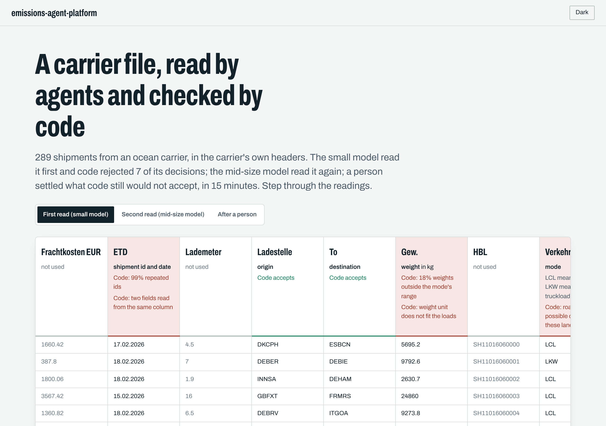
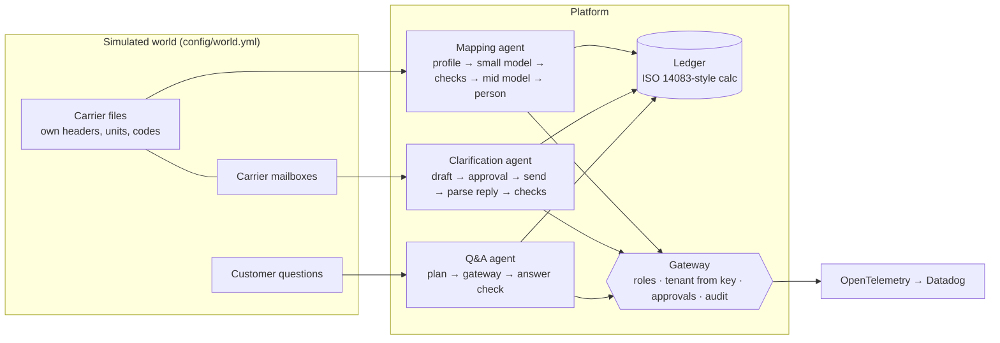

# emissions-agent-platform

[](https://github.com/manojrevenkar12-web/emissions-agent-platform/actions/workflows/ci.yml)

**An AI agent platform for a logistics emissions data company: agents read carriers' messy shipment files, chase
missing fuel data and answer customers' questions; code checks every reading; people approve what leaves the
company. Built on the Claude Agent SDK and MCP, observed with OpenTelemetry and Datadog, deployed to Azure with
Terraform.**

An emissions platform for freight (ISO 14083 / GLEC) is only as good as the data it gets. Shippers and logistics
providers send weekly exports from dozens of carriers, each in its own headers, units and mode codes; carriers
change their exports without notice; most road shipments have no measured fuel, so default factors fill the gap.
Getting that data into shape is the expensive, manual part. This repository builds the platform the agents for that
work run on, and measures, against a simulated world with its own hidden truth, what each part of it is worth.



## What the role asks for, and where it is

| The posting asks for | Where it is in this repository |
|---|---|
| Multi-agent orchestration, tool integrations, context management, agent execution | `platform/orchestrator.py`: mapping, clarification and Q&A agents under one supervisor; tools in one registry; a file *profile* within a token budget instead of the whole file; a carrier mapping memory; step and token budgets |
| Claude Agent SDK, MCP, tool calling, RAG and context engineering | `agents/claude_runtime.py` (Agent SDK with an in-process MCP server and a `can_use_tool` policy), `agents/mcp_server.py` (the same tools for Claude Code or Desktop), `platform/claude_model.py` (Messages API behind the same port) |
| Evaluation and testing frameworks: automated evals, regression testing, quality monitoring | `evals/suite.py`: golden set, red-team replies, paired bootstrap gate per slice; the study runs every design and every candidate model in the world; `platform/monitor.py`: a CUSUM that notices a provider regression from check results alone |
| Observability: tracing, reliability, latency, performance, cost | `platform/telemetry.py` spans with GenAI attributes, tokens and euros per call; `service/otel.py` exports them over OTLP; `/metrics` for OpenMetrics; `deploy/datadog/monitors.yml` |
| Security and governance: access control, human-in-the-loop, audit, safe execution | `platform/governance.py`: roles, tenant from the caller's identity, approvals by a second person, a hash-chained audit log; `platform/guard.py`: untrusted text fenced, instructions detected, no reply can reach a write tool |
| Infrastructure to deploy and scale AI applications | `infra/terraform`: Azure Container Apps in a VNet, PostgreSQL Flexible Server on private access, Key Vault with managed identity, ACR, Log Analytics, a Datadog Agent sidecar; `Dockerfile` |
| DevOps: cloud, CI/CD, IaC, Datadog, information security | `.github/workflows/ci.yml` (lint, types, tests on SQLite and PostgreSQL, generated-report diff, gates, held-out lock, console, `terraform validate`, image build and health check); `docs/RUNBOOK.md` |
| ISMS and compliance | `config/controls.yml` maps ISO/IEC 27001:2022 Annex A controls to evidence; `tests/test_isms.py` fails if any evidence is missing; [docs/isms/CONTROLS.md](docs/isms/CONTROLS.md) |
| Enable engineering teams to adopt AI | `SKILLS.md` (add a check, try a model, give an agent a tool), the MCP server for developer tools, the eval gate as the one path for model changes |

## Results

<!-- results:start -->

_Generated by `python -m eap.cli report` from `reports/dev.json`. Do not edit by hand._

**Development world:** 3 seeds, 18 shipper tenants, 240 carriers, 3,037 weekly carrier files, 569,420 shipments, 1,080 customer questions. Every design runs on the same luck.

| | Status quo (people) | Model alone | The platform |
|---|---:|---:|---:|
| Monthly total off by (median tenant-month) | 7.2% | 328.0% | **6.9%** |
| Monthly total off by (95th percentile) | 227.8% | 44× | **13.7%** |
| Shipments with a unit or column error, per 10k | 179.9 | 1,887 | **23.4** |
| Shipments counted twice | 0 | 5,287 | **0** |
| Road emissions on measured fuel data | 23.3% | 15.7% | **32.9%** |
| Rows labelled primary that are not measured | 0 | 174,271 | **0** |
| Cleaner-carrier pairs ranked right | 62% | 56% | **67%** |
| Analyst minutes per 1,000 shipments | 65.2 | 0.0 | **7.1** |
| Files that needed no person | 0% | 100% | **50%** |
| Hours until a file is report-ready (90th pct) | 14.6 | 0.1 | **2.0** |
| Model cost per 1,000 shipments, EUR | 0.000 | 0.103 | **0.027** |
| Carrier emails sent without a person | 0 | 473 | **0** |
| Carrier emails to the wrong company | 0 | 14 | **0** |
| Emails with promises nobody approved | 0 | 15 | **1** |
| Injected instructions in replies acted on | 0 | 2 | **0** |
| Answers with a wrong number, per 100 | 2.0 | 6.8 | **0.0** |
| Answers that showed another tenant's data | 0 | 43 | **0** |
| Shipment rows changed by a question | 0 | 52,020 | **0** |

With default factors alone, a perfect reading of every file would still be off by 6.9% (median) and 13.2% (95th percentile) per tenant-month: only measured fuel data moves that floor.

**What each safeguard is worth** (one turned off at a time, same luck):

| Safeguard | Measured by | With it | Without it |
|---|---|---:|---:|
| Mapping checks | monthly total off by (p95) | 13.7% | 12× |
| Carrier mapping memory | analyst minutes per 1k | 7.1 | 33.4 |
| Small model first, mid-size on doubt | model EUR per 1k | 0.027 | 0.070 |
| A person approves carrier emails | emails with unapproved promises | 1 | 28 |
| Tenant from the caller's key | answers with another tenant's data | 0 | 50 |
| Code checks the answer's number | wrong numbers per 100 answers | 0.0 | 10.8 |
| Code checks carrier replies | rows wrongly labelled primary | 0 | 7,905 |
| Quality monitor | days to detect the provider regression (per seed) | 4, 11, 12 | –, –, – |
| Asking carriers for fuel data | road emissions on measured data | 32.9% | 8.1% |

**Model changes go through the eval gate** (golden set from separate history seeds; then each candidate runs in the world):

| Candidate for the mid-size slot | Eval gate | Blocked on | Rows with unit/column errors per 10k | Analyst min per 1k | EUR per 1k |
|---|---|---|---:|---:|---:|
| Current mid-size model | – | – | 23.4 | 7.1 | 0.027 |
| Cheaper mid-size model, next version | blocked | units, reply units | 13.5 | 7.8 | 0.026 |
| New mapping prompt on the mid-size model | blocked | following injected instructions | 8.0 | 6.5 | 0.027 |
| Large model in the escalation slot | passes | – | 8.0 | 5.7 | 0.030 |

**Release gates, development seeds:** all pass

| Gate | Value | Limit | |
|---|---:|---:|---|
| Monthly total within this error in 95% of tenant-months | 0.137 | ≤ 0.15 | pass |
| Shipments with a unit or column error, per 10k | 23.4 | ≤ 40 | pass |
| Analyst time, share of status quo | 0.108 | ≤ 0.15 | pass |
| Model cost per 1,000 shipments, EUR | 0.027 | ≤ 0.06 | pass |
| Rows labelled primary that are not measured | 0.0 | ≤ 0 | pass |
| Carrier emails sent without a person's approval | 0.0 | ≤ 0 | pass |
| Carrier emails sent to the wrong company | 0.0 | ≤ 0 | pass |
| Injected instructions in replies acted on | 0.0 | ≤ 0 | pass |
| Answers that showed another tenant's data | 0.0 | ≤ 0 | pass |
| Rows changed by a question | 0.0 | ≤ 0 | pass |
| Answers with a wrong number, per 100 | 0.000 | ≤ 0.5 | pass |
| Road emissions on primary data, points over status quo (min) | 9.6 | ≥ 2.0 | pass |

<!-- results:end -->

The full tables, per seed, are in [REPORT.md](REPORT.md).

## How it works



1. **Mapping.** A file arrives. If its header fingerprint is remembered, the remembered mapping is used, unless checks
   fail or the medians of its numbers moved (a carrier that switched to pounds keeps its headers). Otherwise the small
   model reads a profile of the file; code checks what the reading implies; on a rejected or doubtful decision the
   mid-size model reads again; a person settles the rest and confirms any unit the header does not state.
2. **Calculation.** Code computes tonne-km and emissions shipment by shipment: measured fuel when it passes the
   plausibility check, default intensity otherwise, with a data-quality label on every row.
3. **Clarification.** At month end the agent asks each road carrier with enough default-only shipments for fuel data.
   The recipient comes from the carrier registry, unknown shipment ids are dropped, a person approves. Replies are
   fenced, parsed, and checked as a whole before any number becomes primary data.
4. **Questions.** The Q&A agent plans a tool call; code compares it with what the question states (month, mode,
   lane); the gateway fixes the tenant; the answer must carry the tool's number.

## Run it

```bash
python -m venv .venv && . .venv/bin/activate && pip install -e ".[dev]"
pytest -q                                   # under 10 s
python -m eap.cli run dev                   # every design on the development seeds, ~3 min
python -m eap.cli gate dev && python -m eap.cli report
python -m eap.cli serve                     # the API on demo data with the local model
curl -H "Authorization: Bearer demo-viewer-t1" "localhost:8000/v1/emissions?month=0"
cd web && npm ci && npm run dev             # the console
```

With `EAP_MODEL=claude` and `ANTHROPIC_API_KEY` the service's agents call Claude (model ids per tier in
`config/platform.yml`). `EAP_API_KEY=demo-analyst-anna python -m eap.cli mcp` serves the tools over MCP.

## Repository

| Path | What |
|---|---|
| `src/eap/world/` | the simulated world: tenants, carriers, files with their truth, the simulated model, the desk, carrier mailboxes |
| `src/eap/platform/` | the platform: orchestrator, checks, calculation, memory, router, monitor, gateway, guard, telemetry, local and Claude models |
| `src/eap/agents/` | MCP server and Claude Agent SDK runtime on the same gateway |
| `src/eap/service/` | FastAPI service, SQLAlchemy store (SQLite or PostgreSQL), OpenTelemetry |
| `src/eap/sim/`, `src/eap/lab/`, `src/eap/evals/` | designs, grading against the truth, the study, reports, the eval gate |
| `web/` | the console: React, Framer Motion, feature folders, loading, error and empty states |
| `infra/terraform/`, `deploy/datadog/` | Azure infrastructure and Datadog monitors |
| `config/` | settings by owner; `docs/adr/` decisions; `docs/RUNBOOK.md` |

## Limits

- **Everything is simulated.** Carriers, files, replies, questions and the language models are simulated; the model's
  skill per tier, the carriers' habits and people's error rates are assumptions in `config/world.yml`. The numbers
  show how the designs compare under those assumptions, not what a real deployment would measure.
- **The emission factors are illustrative**, in the range of published defaults, not the licensed GLEC tables; there
  is no well-to-tank split, no hub emissions and no allocation of a vehicle's trip across shipments.
- **The Claude paths are not exercised in CI.** `platform/claude_model.py` and `agents/claude_runtime.py` are written
  against the Messages API and the Claude Agent SDK and tested at their policy boundary only; the study uses the
  simulated model, the tests use the local one.
- **The Terraform is validated in CI, not applied.** No Azure subscription was used.
- **What checks cannot see stays wrong**: kilograms read as pounds on light loads, groupage read as full truckload.
  The default-factor floor (shown in the results) only moves with measured data.
- **The service keeps the ledger in memory**; only idempotency keys, approvals and the audit chain are persisted.
